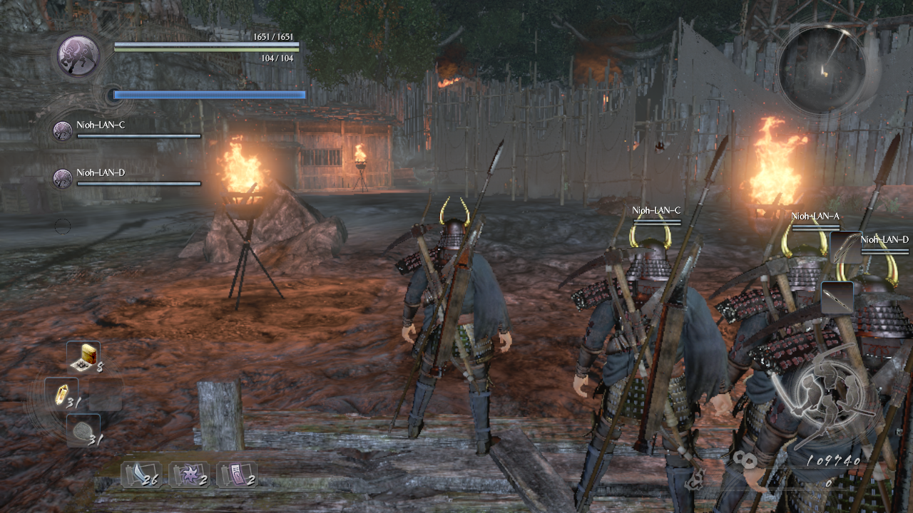

# nioh4p

Three- and four-player co-op for Nioh: Complete Edition on Steam.


Every player needs the same game build and core mod.

A four-player group has entered one Torii Gate mission on a four-instance
test setup, with three companion bars on every screen. The extra bar is a
plain gauge for now: no name label, and its fill does not track its own
companion. Four-account play over the internet, mission completion, and the
gameplay add-ons' combat behavior remain unproven. Follow the instructions
inside your package.

## Install and play

1. Back up your saves and close Nioh.
2. In Steam, open Nioh's local files.
3. Extract `nioh4p-all.zip` into the game folder - or copy `dinput8.dll` and
   `nioh3p.ini` from `nioh4p-player.zip` beside `nioh.exe`.
   If another mod uses `dinput8.dll`, read the [plugin instructions](package/README.md#install-the-core-as-a-plugin) first.
4. The defaults fit four players. For a three-player group, set
   `max_players=3` in every player's `nioh3p.ini`.

5. Start the game from Steam on every computer.
6. Open Torii Gate, then Yokai Realm with a Companion.
7. Let the host search first. Let the visitors search before the preparation countdown ends.

Use a mission that everyone can access. Keep Secret Word Off for this test.
Without Conditions is not a private search. Read the [full player instructions](package/README.md) before joining.

For other mods that install a loader DLL, read
[compatibility with other mods](package/README.md#compatibility-with-other-mods).

On Linux or Steam Deck, if the mod does not load, use this Steam launch option:

```sh
WINEDLLOVERRIDES="dinput8=n,b" %command%
```

Optional add-ons separate shrine use, Kodama collection, enemy health, assist-gauge drain, and shrine recovery from the core.
The all-in-one zip ships all of them enabled; delete an add-on's DLL, or set `enabled=0` in its INI, to turn one off.
Their live behavior is still under test.

The mod is unsigned. If antivirus blocks it, keep protection enabled and report the detection.
Review logs before sharing them. They can contain lobby IDs and file paths.
To uninstall, close Nioh and remove only the mod files that you installed:
`dinput8.dll`, `nioh3p.ini`, the `DLLMods\nioh4p*` files and the `nioh3p*.log` logs.

Not affiliated with or endorsed by Koei Tecmo or Team Ninja.

[Releases](https://github.com/Kenja-mc/nioh4p/releases) ·
[Safety](docs/SAFETY.md) ·
[Source and test guidance](AGENTS.md)
